# IA embarquée — Un MLP pour la reconnaissance de chiffres MNIST sur STM32

**De l'entraînement sous TensorFlow/Keras à la reconnaissance de chiffres manuscrits directement sur un microcontrôleur STM32L4R9, grâce à ST X-CUBE-AI**

🇫🇷 Version française · [🇬🇧 English version](README.en.md)

> **Résumé.** Ce projet déroule une chaîne complète d'IA embarquée, de la donnée brute jusqu'à l'inférence sur puce. Nous entraînons avec TensorFlow/Keras un perceptron multicouche (MLP) de topologie 784-128-64-10 sur une version équilibrée de MNIST : il atteint **97,43 %** de précision sur le jeu de test. Le modèle TensorFlow Lite en float32 est ensuite analysé et converti en code C par ST Edge AI Core (X-CUBE-AI 10.2.0), puis intégré à un firmware STM32CubeIDE pour la carte STM32L4R9I-DISCO (Cortex-M4F). Le réseau occupe 437 544 octets de poids, 3 648 octets d'activations et demande 109 728 opérations multiplication-accumulation (MACC) par inférence. Un petit protocole UART (poignée de main, 784 flottants en entrée, 10 octets en sortie) relie un ordinateur hôte au microcontrôleur pour classer les images une à une.
>
> **Mots-clés :** IA embarquée, TinyML, MLP, MNIST, STM32, X-CUBE-AI, ST Edge AI Core, TensorFlow/Keras, TensorFlow Lite, UART, Cortex-M4.

---

## Sommaire

1. [Présentation du projet](#1-présentation-du-projet)
2. [Données et prétraitement](#2-données-et-prétraitement)
3. [Architecture du MLP](#3-architecture-du-mlp)
4. [Entraînement et évaluation](#4-entraînement-et-évaluation)
5. [Conversion et déploiement du modèle](#5-conversion-et-déploiement-du-modèle)
6. [Implémentation sur STM32](#6-implémentation-sur-stm32)
7. [Communication UART](#7-communication-uart)
8. [Résultats expérimentaux](#8-résultats-expérimentaux)
9. [Conclusion et pistes d'amélioration](#9-conclusion-et-pistes-damélioration)
10. [Structure du dépôt et références](#10-structure-du-dépôt-et-références)

---

## 1. Présentation du projet

### 1.1 Contexte et motivation

Faire tourner un réseau de neurones directement sur un microcontrôleur, c'est se passer de connexion réseau et de serveur distant, gagner en latence et garder les données sur l'appareil. En contrepartie, la plateforme est très contrainte : quelques centaines de kilo-octets de mémoire, pas de système d'exploitation, une fréquence d'horloge modeste. La reconnaissance de chiffres manuscrits sur MNIST est le « hello world » classique de ce domaine : assez petite pour tenir sur une puce, assez complète pour parcourir toute la chaîne, de la donnée au modèle déployé.

### 1.2 Objectifs

- Entraîner un MLP compact pour classer les chiffres de 0 à 9 avec TensorFlow/Keras.
- Évaluer sérieusement ce modèle (précision, perte, matrice de confusion, exemples de prédictions).
- Le convertir en code C avec **ST X-CUBE-AI** et mesurer son empreinte mémoire et son coût de calcul sur une cible STM32L4.
- Intégrer le réseau généré dans un firmware STM32CubeIDE et l'exposer par une interface **UART** simple.

### 1.3 Vue d'ensemble de la chaîne

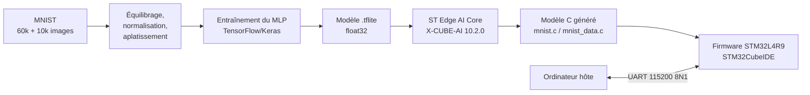

| Étape | Outil | Où dans le dépôt |
|---|---|---|
| Préparation des données, entraînement, évaluation | Python, TensorFlow/Keras, scikit-learn, Matplotlib | `emnist.ipynb` |
| Modèle déployable | TensorFlow Lite (float32) | `5dense-mnist-10class-finetuned.tflite` |
| Analyse et génération du code C | ST Edge AI Core v2.2.0 / X-CUBE-AI 10.2.0 | `Embedded_AI/X-CUBE-AI/` |
| Firmware | STM32CubeIDE, HAL STM32 | `Embedded_AI/` |

> **À propos du périmètre.** La fin du notebook contient des cellules commentées pour le convertisseur *AIfES*. Elles ne servent pas dans ce projet : le déploiement embarqué repose uniquement sur X-CUBE-AI.

---

## 2. Données et prétraitement

### 2.1 Le jeu de données MNIST

MNIST rassemble des images en niveaux de gris de 28 × 28 pixels représentant des chiffres manuscrits (classes 0 à 9) : 60 000 pour l'entraînement et 10 000 pour le test. Le notebook les charge avec `tf.keras.datasets.mnist.load_data()` et traite chaque image comme un vecteur de $D = 28 \times 28 = 784$ intensités.

<p align="center">
  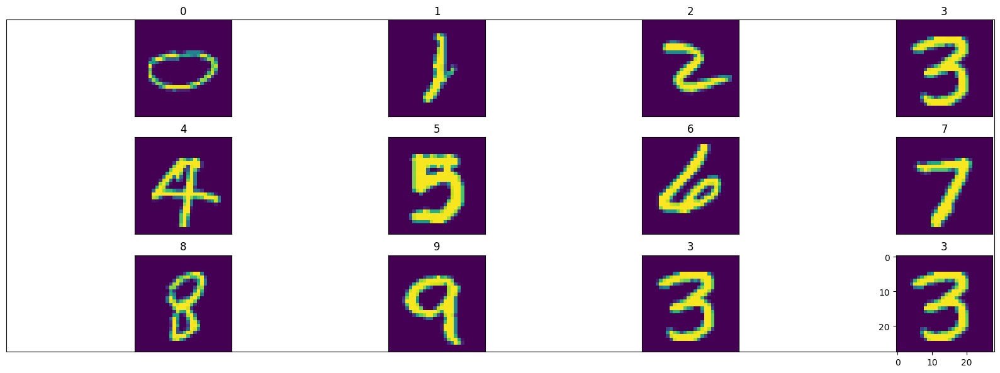
  <br>
  <em>Figure 1. Une image d'entraînement MNIST par classe (0 à 9). Les deux dernières cases répètent une image pour compléter la grille d'affichage.</em>
</p>

### 2.2 Chaîne de prétraitement

Le notebook enchaîne les étapes suivantes :

1. **Normalisation** — les pixels passent de $[0, 255]$ à $[-0{,}5,\, 0{,}5]$ :

$$
\tilde{x} = \frac{x}{255} - 0.5
$$

2. **Équilibrage des classes** — pour chaque classe, on ne garde que les $n_{\min}$ premières images, où $n_{\min}$ est l'effectif de la plus petite classe (5 421 en entraînement, 892 en test). On obtient **54 210** images d'entraînement et **8 920** images de test, avec exactement le même nombre d'exemples pour chaque chiffre.
3. **Mélange** — les deux jeux sont permutés aléatoirement.
4. **Aplatissement** — chaque image devient un vecteur $\mathbf{x} \in \mathbb{R}^{784}$, le format d'entrée du MLP.

Les étiquettes restent des entiers (0 à 9), comme l'exige la perte d'entropie croisée catégorielle « sparse ».

<table align="center">
  <tr>
    <td align="center">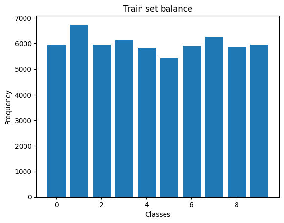<br><em>(a) Entraînement, d'origine</em></td>
    <td align="center">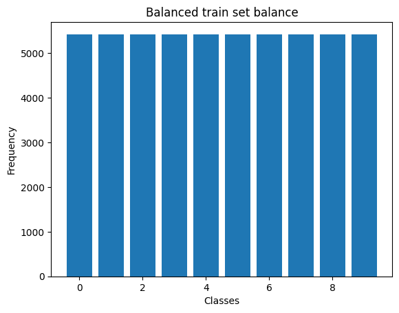<br><em>(b) Entraînement, équilibré</em></td>
  </tr>
  <tr>
    <td align="center">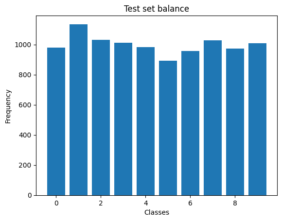<br><em>(c) Test, d'origine</em></td>
    <td align="center">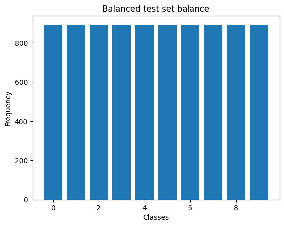<br><em>(d) Test, équilibré</em></td>
  </tr>
</table>

<p align="center"><em>Figure 2. Effectifs par classe avant et après équilibrage. Ce dernier gomme le léger déséquilibre de MNIST : la précision ne favorise plus les chiffres les plus fréquents.</em></p>

| Jeu | Taille d'origine | Taille équilibrée | Exemples par classe |
|---|---:|---:|---:|
| Entraînement | 60 000 | 54 210 | 5 421 |
| Test | 10 000 | 8 920 | 892 |

> **Point d'attention pour le déploiement.** Le réseau a été entraîné avec des entrées dans $[-0{,}5, 0{,}5]$. Le firmware ne fait **aucun prétraitement** : ce que l'hôte envoie par l'UART est donné tel quel au réseau. C'est donc à l'hôte d'appliquer la même normalisation (voir la [section 7](#7-communication-uart)).

---

## 3. Architecture du MLP

Le classifieur est un modèle Keras `Sequential` composé de trois couches entièrement connectées (`Dense`).

| N° | Couche | Forme de sortie | Activation | Paramètres |
|---:|---|---:|---|---:|
| 0 | Entrée (image aplatie) | 784 | — | 0 |
| 1 | Dense | 128 | ReLU | 784 × 128 + 128 = 100 480 |
| 2 | Dense | 64 | ReLU | 128 × 64 + 64 = 8 256 |
| 3 | Dense | 10 | Softmax | 64 × 10 + 10 = 650 |
| | **Total** | | | **109 386** (427,29 Kio en float32) |

Pour un vecteur d'entrée $\mathbf{x}$, la passe avant s'écrit :

$$
\mathbf{h}_1 = \mathrm{ReLU}(W_1 \mathbf{x} + \mathbf{b}_1), \qquad
\mathbf{h}_2 = \mathrm{ReLU}(W_2 \mathbf{h}_1 + \mathbf{b}_2), \qquad
\mathbf{z} = W_3 \mathbf{h}_2 + \mathbf{b}_3
$$

avec $W_1 \in \mathbb{R}^{128 \times 784}$, $W_2 \in \mathbb{R}^{64 \times 128}$, $W_3 \in \mathbb{R}^{10 \times 64}$ et $\mathrm{ReLU}(u) = \max(0, u)$. La couche de sortie softmax transforme les logits $\mathbf{z}$ en une distribution de probabilité sur les dix classes :

$$
\hat{y}_k = \frac{e^{z_k}}{\sum_{j=0}^{9} e^{z_j}}, \qquad \hat{c} = \arg\max_k \hat{y}_k
$$

On retrouve exactement cette topologie (784 → 128 → 64 → 10) dans le modèle converti : la vue réseau de CubeMX ci-dessous montre trois blocs `Dense`, chacun suivi d'une non-linéarité (ReLU, ReLU, Softmax).

<p align="center">
  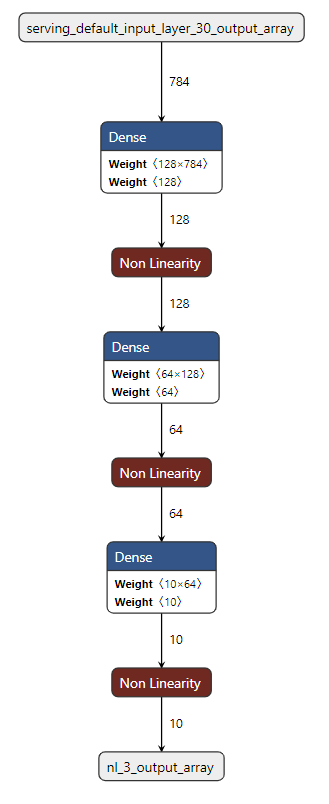
  <br>
  <em>Figure 3. Graphe du modèle importé dans STM32CubeMX / X-CUBE-AI : Dense (128×784) → ReLU → Dense (64×128) → ReLU → Dense (10×64) → Softmax.</em>
</p>

---

## 4. Entraînement et évaluation

### 4.1 Paramètres d'entraînement

| Hyperparamètre | Valeur |
|---|---|
| Perte | Entropie croisée catégorielle « sparse » (`from_logits=False`) |
| Optimiseur | Adam |
| Taux d'apprentissage | 1 × 10⁻³ |
| Taille de lot | 128 (424 itérations par époque) |
| Époques | 20 |
| Données d'entraînement | 54 210 images équilibrées |
| Données de validation | 8 920 images de test équilibrées |

La perte minimisée sur $N$ exemples d'entraînement est

$$
\mathcal{L} = -\frac{1}{N} \sum_{i=1}^{N} \log \hat{y}_{i,\,c_i}
$$

où $c_i$ est la vraie classe de l'exemple $i$. Il n'y a ni régularisation, ni augmentation de données, ni arrêt précoce. Précision importante : le notebook utilise le **jeu de test équilibré comme jeu de validation** pendant l'entraînement. Il n'existe donc pas de jeu de test réellement indépendant, et les chiffres de test sont, par principe, légèrement optimistes (voir la [section 9](#9-conclusion-et-pistes-damélioration)).

### 4.2 Courbes d'apprentissage

<p align="center">
  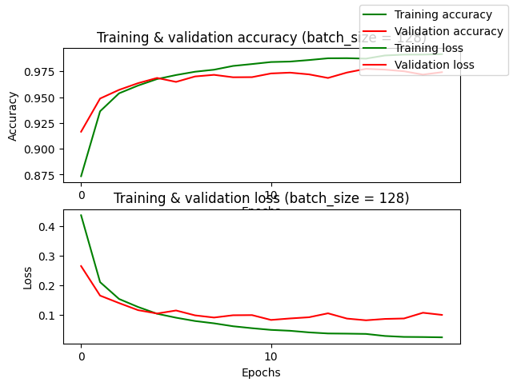
  <br>
  <em>Figure 4. Précision (en haut) et perte (en bas) en entraînement et en validation sur 20 époques, telles que produites par le notebook.</em>
</p>

La précision d'entraînement monte régulièrement de 87,3 % (époque 1) à 99,2 % (époque 20), tandis que la perte passe de 0,437 à 0,0245. En validation, la précision grimpe vite pendant les cinq premières époques (environ 96,9 %), puis se stabilise entre 97,0 % et 97,8 % environ (meilleure valeur : 97,76 % à l'époque 16). La perte de validation, elle, reste autour de 0,08–0,11. L'écart qui se creuse entre les deux courbes trahit un léger surapprentissage, ce qui n'a rien de surprenant pour un MLP sans régularisation sur MNIST.

### 4.3 Évaluation finale

| Jeu | Précision | Perte |
|---|---:|---:|
| Entraînement (54 210 images) | 99,30 % | 0,0220 |
| Test (8 920 images) | **97,43 %** | 0,1003 |

### 4.4 Matrice de confusion

<p align="center">
  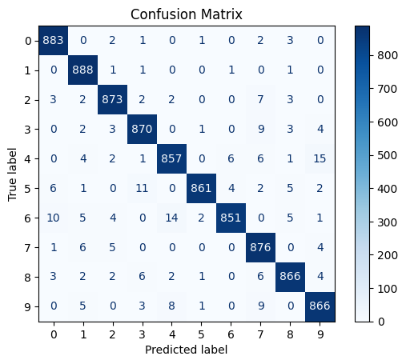
  <br>
  <em>Figure 5. Matrice de confusion sur le jeu de test équilibré (892 images par classe).</em>
</p>

La diagonale domine nettement : 8 691 des 8 920 images de test sont bien classées (97,43 %), ce qui concorde avec l'évaluation ci-dessus. Les erreurs les plus fréquentes concernent des chiffres qui se ressemblent : des 4 pris pour des 9 (15 cas), des 6 pris pour des 4 (14), des 5 pris pour des 3 (11) et des 6 pris pour des 0 (10).

### 4.5 Exemples de prédictions

<p align="center">
  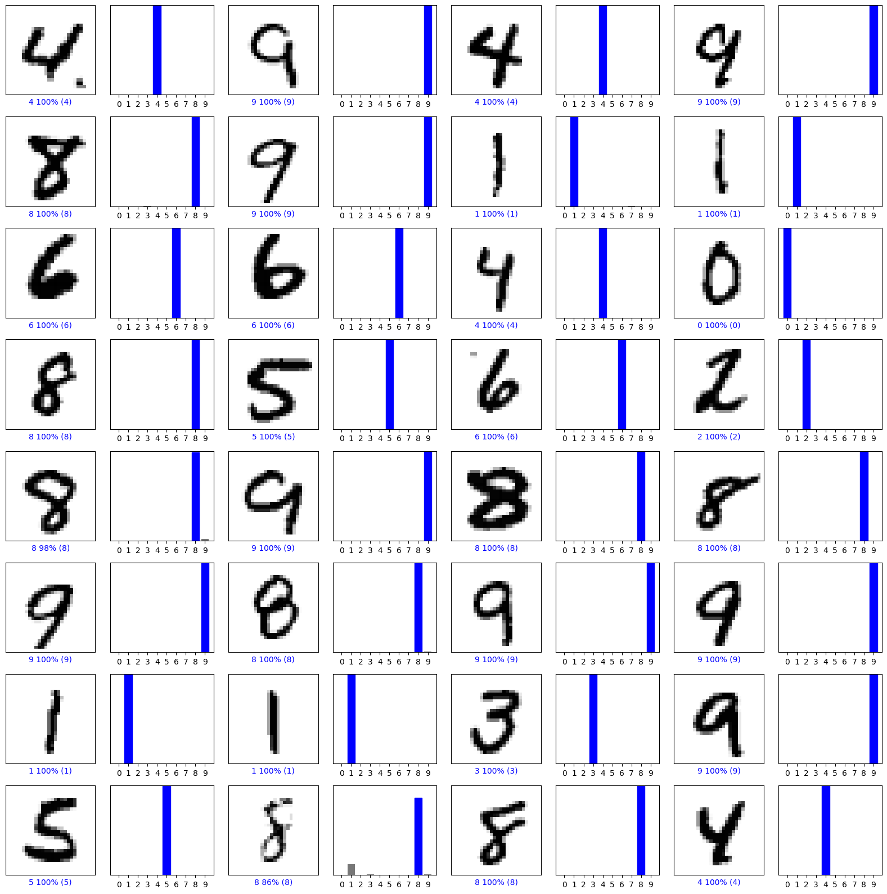
  <br>
  <em>Figure 6. 32 images de test tirées au hasard, avec l'étiquette prédite, la confiance associée et la vraie étiquette entre parenthèses. Le bleu indique une prédiction correcte, le rouge une erreur ; les histogrammes montrent la sortie softmax (barre bleue : vraie classe, barre rouge : classe prédite lorsqu'elle est fausse).</em>
</p>

> Les exemples sont tirés au hasard et le notebook ne fixe aucune graine aléatoire : cette figure, comme les courbes ci-dessus, sera légèrement différente si vous relancez le notebook.

---

## 5. Conversion et déploiement du modèle

### 5.1 Trois technologies à ne pas confondre

| Technologie | Rôle dans le projet |
|---|---|
| **TensorFlow / Keras** | Définition, entraînement et évaluation du modèle dans `emnist.ipynb`. Le modèle entraîné est enregistré au format HDF5 (`.h5`) avec son historique d'entraînement. |
| **TensorFlow Lite** | Modèle sérialisé en float32 `5dense-mnist-10class-finetuned.tflite`, qui sert d'entrée aux outils ST. Il a la même topologie et le même nombre de paramètres (109 386) que le modèle Keras. |
| **ST X-CUBE-AI / ST Edge AI Core** | Extension STM32Cube qui analyse le fichier `.tflite` et génère du code C optimisé ainsi qu'une bibliothèque d'exécution pour Cortex-M. |

Le notebook ne contient pas la cellule qui convertit le modèle Keras en TensorFlow Lite : le fichier `.tflite` est fourni tel quel dans le dépôt. Le fichier `.h5` et le JSON d'historique écrits par le notebook ne sont pas versionnés.

### 5.2 Réglages de conversion

Le modèle a été importé dans STM32CubeMX avec X-CUBE-AI 10.2.0 (ST Edge AI Core v2.2.0). Voici les réglages utiles, tirés du rapport de génération :

| Paramètre | Valeur |
|---|---|
| Modèle d'entrée | `5dense-mnist-10class-finetuned.tflite` (float32) |
| Nom du réseau généré | `mnist` |
| Famille cible | `stm32l4` |
| Compression | aucune |
| Optimisation | équilibrée (`balanced`) |
| Options | `allocate-inputs`, `allocate-outputs` (les tampons d'entrée/sortie sont placés dans le tampon d'activations) |
| Bibliothèque d'exécution | `NetworkRuntime1020_CM4_GCC.a` (Cortex-M4, GCC) |

Le modèle reste en **virgule flottante (float32)** : aucune quantification n'est appliquée.

### 5.3 Analyse du réseau converti

ST Edge AI Core associe chaque couche Dense à son activation dans une couche C fusionnée : on obtient trois étages Dense/non-linéarité, puis un Softmax final.

| Couche (X-CUBE-AI) | Type | Forme de sortie | MACC |
|---|---|---:|---:|
| `gemm_0` + `nl_0_nl` | Dense + ReLU | 128 | 100 480 + 128 |
| `gemm_1` + `nl_1_nl` | Dense + ReLU | 64 | 8 256 + 64 |
| `gemm_2` | Dense | 10 | 650 |
| `nl_3` | Softmax | 10 | 150 |
| **Total** | | | **109 728** |

Les couches Dense représentent 99,7 % des opérations (`smul_f32_f32`, 109 386 MACC) ; les 0,3 % restants viennent des fonctions d'activation.

| Ressource | Taille | Détail |
|---|---:|---|
| Poids (lecture seule, Flash) | 437 544 o (427,29 Kio) | 109 386 paramètres float32 |
| Runtime X-CUBE-AI (Flash) | 10 062 o (9,83 Kio) | noyaux + infrastructure + objets de la chaîne de compilation |
| **Flash total** | **447 606 o (437,12 Kio)** | ≈ 21 % des 2 Mio de Flash du STM32L4R9 |
| Activations (RAM) | 3 648 o (3,56 Kio) | inclut les tampons d'entrée (3 136 o) et de sortie (40 o) |
| Runtime X-CUBE-AI (RAM) | 1 988 o (1,94 Kio) | |
| **RAM totale** | **5 636 o (5,50 Kio)** | < 1 % des 640 Kio de SRAM du STM32L4R9 |

> Les pourcentages par rapport à la capacité du composant sont calculés à partir des chiffres ci-dessus et des tailles mémoire publiées du STM32L4R9 (2 Mio de Flash, 640 Kio de SRAM) ; ils ne figurent pas dans le rapport ST.

Les captures suivantes viennent de l'étape *Analyze* de STM32CubeMX et confirment ces chiffres.

<p align="center">
  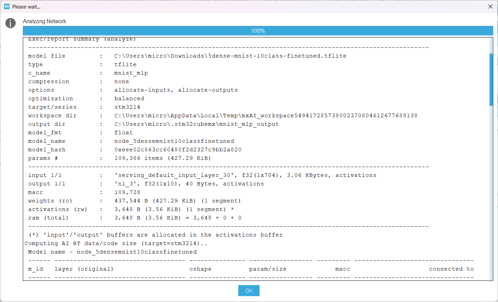
  <br>
  <em>Figure 7. Rapport d'analyse : type de modèle (tflite), cible (stm32l4), 109 386 paramètres, 109 728 MACC, 437 544 o de poids et 3 648 o d'activations.</em>
</p>

<p align="center">
  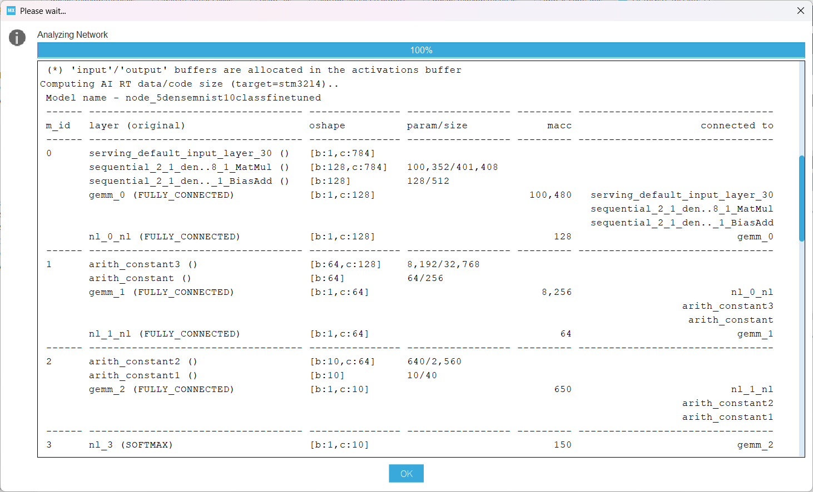
  <br>
  <em>Figure 8. Correspondance couche par couche : chaque couche Dense (<code>gemm_*</code>) est fusionnée avec sa non-linéarité ; poids et biais sont stockés comme constantes.</em>
</p>

<p align="center">
  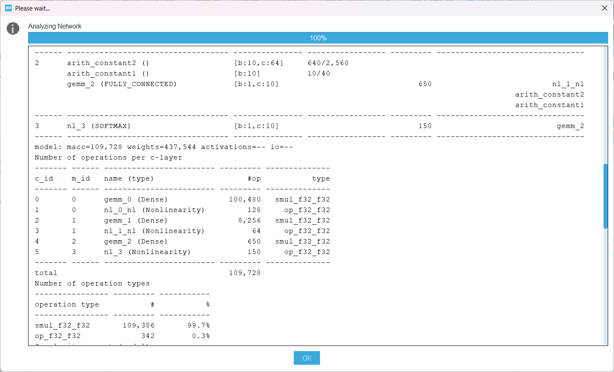
  <br>
  <em>Figure 9. Opérations par couche C générée : 100 480 MACC pour la première couche Dense, 8 256 pour la deuxième et 650 pour la couche de sortie.</em>
</p>

<p align="center">
  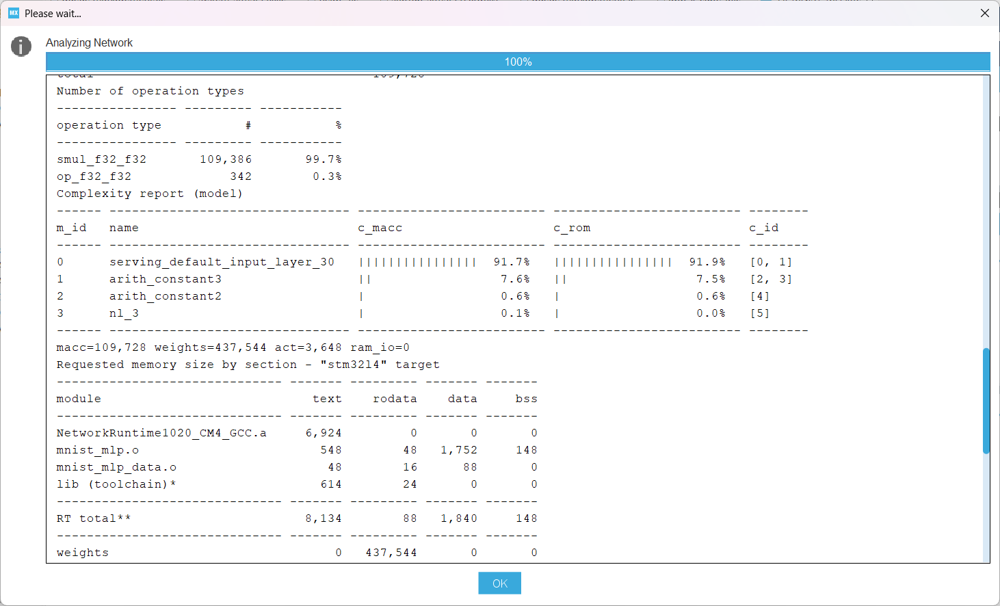
  <br>
  <em>Figure 10. Rapport de complexité et mémoire demandée par section (bibliothèque d'exécution, code du modèle généré, poids, activations).</em>
</p>

<p align="center">
  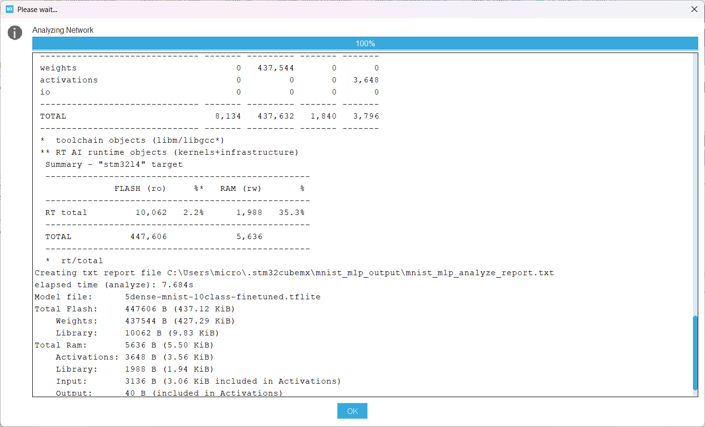
  <br>
  <em>Figure 11. Synthèse Flash et RAM pour la cible <code>stm32l4</code> : 447 606 o de Flash et 5 636 o de RAM au total.</em>
</p>

---

## 6. Implémentation sur STM32

### 6.1 Plateforme cible

| Élément | Valeur |
|---|---|
| Carte | STM32L4R9I-DISCO |
| Microcontrôleur | STM32L4R9AIIx (Arm Cortex-M4F) |
| Chaîne d'outils / IDE | STM32CubeIDE, pilotes HAL STM32L4xx |
| Horloge système | MSI (4 MHz) → PLL (M = 1, N = 60, R = 2) → **120 MHz**, 5 états d'attente Flash |
| Paquet IA | X-CUBE-AI 10.2.0, « Application template » |
| Liaison avec l'hôte | USART2 (PA2 TX / PA3 RX), 115200 bauds, 8N1, sans contrôle de flux |

Le projet CubeMX (`Embedded_AI.ioc`) reprend la configuration standard de la carte et active aussi des périphériques que cette application n'utilise pas (FMC, I2C1, SAI1, SDMMC1, SPI2, USB OTG FS, USART3).

### 6.2 Code généré ou écrit à la main

| Catégorie | Fichiers | Origine |
|---|---|---|
| Réseau de neurones | `mnist.c/.h`, `mnist_data.c/.h`, `mnist_data_params.c/.h`, `mnist_config.h`, `mnist_generate_report.txt` | **Généré** par ST Edge AI Core |
| Runtime IA | `Middlewares/ST/AI/` (`NetworkRuntime1020_CM4_GCC.a`, en-têtes) | Bibliothèque ST (X-CUBE-AI) |
| Squelette du projet | `Core/Src/main.c`, pilotes HAL, fichier de démarrage, scripts d'édition de liens | **Généré** par STM32CubeMX |
| Logique applicative | Sections `USER CODE` de `X-CUBE-AI/App/app_x-cube-ai.c` | **Écrit à la main** |

Tout le code propre à l'application se trouve dans les blocs `USER CODE` de `app_x-cube-ai.c` : la poignée de main UART (`synchronize_UART`), l'acquisition de l'entrée (`acquire_and_process_data`), la mise en forme de la sortie (`post_process`) et la boucle principale (`MX_X_CUBE_AI_Process`). Quant à `main.c`, il se contente d'initialiser la HAL, l'arbre d'horloge et les périphériques, d'appeler `MX_X_CUBE_AI_Init()` une fois, puis `MX_X_CUBE_AI_Process()` en boucle infinie.

### 6.3 Déroulement d'une inférence

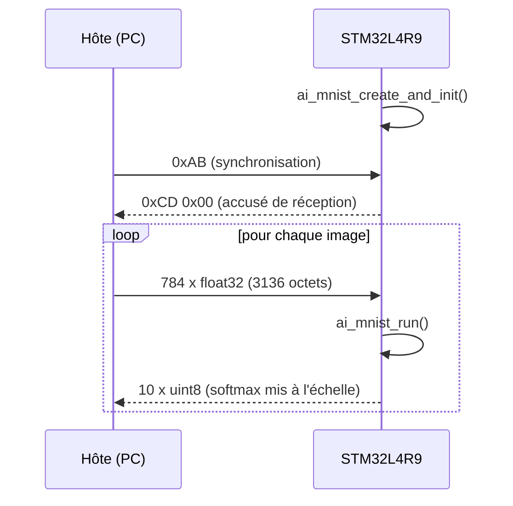

1. **Initialisation** — `ai_mnist_create_and_init()` instancie le réseau avec un tampon d'activations statique, aligné sur 32 octets (`pool0`, dimensionné par `AI_MNIST_DATA_ACTIVATION_1_SIZE`). Comme le modèle a été généré avec `allocate-inputs`/`allocate-outputs`, les tenseurs d'entrée et de sortie vivent dans ce tampon ; le firmware n'a qu'à récupérer leurs pointeurs (`data_ins`, `data_outs`) auprès du réseau.
2. **Acquisition** — après la poignée de main UART, les 3 136 octets sont reçus directement dans le tampon d'entrée du réseau.
3. **Inférence** — `ai_mnist_run()` exécute la passe avant en float32 (trois couches Dense et leurs activations) avec le runtime X-CUBE-AI.
4. **Post-traitement** — les 10 probabilités softmax sont converties en octets puis renvoyées.

La boucle continue tant que la réception, l'inférence et l'émission se passent bien ; une erreur UART l'arrête et signale l'échec.

---

## 7. Communication UART

Le microcontrôleur joue le rôle d'un serveur d'inférence passif, piloté par l'hôte via l'USART2 (115200 bauds, 8 bits de données, sans parité, 1 bit d'arrêt).

| Étape | Sens | Contenu | Description |
|---|---|---|---|
| 1. Synchronisation | Hôte → MCU | 2 octets, le premier valant `0xAB` | Le MCU attend l'octet de synchronisation (délai de réception de 1 s, réessayé indéfiniment). |
| 2. Accusé de réception | MCU → Hôte | `0xCD 0x00` | Confirme que la carte est prête. |
| 3. Image d'entrée | Hôte → MCU | 3 136 octets = 784 × float32 | Image 28 × 28 aplatie, flottants IEEE-754 bruts, ligne par ligne, dans $[-0{,}5, 0{,}5]$ (même normalisation qu'à l'entraînement). |
| 4. Prédiction | MCU → Hôte | 10 octets (`uint8`) | Pour chaque classe $k$ : $o_k = \lfloor 255\,\hat{y}_k \rfloor$ |

Les étapes 3 et 4 se répètent pour chaque image. Côté hôte, le chiffre prédit s'obtient par $\hat{c} = \arg\max_k o_k$. Un octet par classe donne une résolution de 1/255 : c'est largement suffisant pour classer les sorties, mais cela ne reflète qu'approximativement les vraies probabilités softmax.

À titre indicatif, une trame UART de 10 bits à 115200 bauds transfère les 3 136 octets d'entrée en 0,27 s environ, alors que la réponse de 10 octets prend moins d'une milliseconde. À cette vitesse, **c'est donc la communication qui domine la latence de bout en bout** du démonstrateur. Ce chiffre est calculé à partir du débit de la liaison ; il n'a pas été mesuré.

> Le dépôt ne contient que la partie firmware du protocole : aucun script côté hôte n'est fourni.

---

## 8. Résultats expérimentaux

### 8.1 Qualité du modèle (TensorFlow/Keras, sur l'hôte)

| Mesure | Valeur |
|---|---:|
| Précision en test (8 920 images équilibrées) | **97,43 %** |
| Perte en test | 0,1003 |
| Précision en entraînement | 99,30 % |
| Meilleure précision en validation pendant l'entraînement | 97,76 % (époque 16) |

Le détail est discuté dans la [section 4](#4-entraînement-et-évaluation) (figures 4 à 6).

### 8.2 Empreinte embarquée (ST Edge AI Core, cible `stm32l4`)

| Mesure | Valeur |
|---|---:|
| Paramètres | 109 386 (float32) |
| Calcul par inférence | 109 728 MACC |
| Flash (poids + runtime) | 447 606 o (437,12 Kio) |
| RAM (activations + runtime) | 5 636 o (5,50 Kio) |

Ces valeurs proviennent des rapports d'analyse et de génération et apparaissent dans les figures 7 à 11. Le fichier `.ioc` mentionne une estimation de Flash un peu différente (448 244 o) ; nous nous appuyons ici sur les rapports.

### 8.3 Validation de l'inférence embarquée

Voici ce que le dépôt permet d'établir :

- Le réseau a bien été généré et analysé pour la cible `stm32l4` (section 5).
- La topologie, le nombre de paramètres (109 386) et le nombre d'opérations (109 728 MACC) du modèle C généré correspondent exactement à l'architecture Keras (section 3).
- Le firmware a été compilé avec STM32CubeIDE pour le STM32L4R9AIIx (le dossier `Debug/` contient l'ELF et les fichiers map obtenus).

En revanche, le dépôt **ne contient aucune mesure faite sur la carte** : ni précision sur cible, ni temps d'inférence (nombre de cycles), ni journal d'une session UART. Nous n'en rapportons donc aucune. Les tableaux de `Test_files/` (`MNIST_xtest_NN_C2_16_10.npy` et `MNIST_ytest_NN_C2_16_10.npy`) ont la forme `(10000, 28, 28, 1)`, des valeurs dans $[0, 1]$ et des étiquettes en one-hot. Leurs noms et les réglages de validation de CubeMX laissent penser qu'ils appartiennent à un réseau antérieur (`NN_C2_16_10`). Ils ne correspondent pas au format d'entrée de ce MLP (vecteur plat de 784 valeurs dans $[-0{,}5, 0{,}5]$) sans conversion ; nous ne nous en servons donc pour aucun résultat.

---

## 9. Conclusion et pistes d'amélioration

### 9.1 Conclusion

Un MLP d'environ 109 000 paramètres, entraîné sur MNIST équilibré, atteint 97,43 % de précision en test. Avec X-CUBE-AI, ce modèle float32 devient un code C qui occupe environ 437 Kio de Flash et 5,5 Kio de RAM : une petite fraction de la mémoire du STM32L4R9, qui laisse beaucoup de place au reste de l'application. Un protocole UART minimal permet de classer des images depuis un ordinateur hôte. Le projet montre ainsi le chemin complet, de la préparation des données et de l'entraînement jusqu'au déploiement sur un microcontrôleur Cortex-M4F.

### 9.2 Pistes d'amélioration

- **Quantification** — passer les poids et les activations en int8 (quantification post-entraînement) pour diviser l'empreinte Flash par environ 4 et accélérer l'inférence sur le Cortex-M4, puis comparer la précision au modèle float32.
- **Validation systématique sur cible** — faire passer les images de test par la carte (ou par la fonction *validate on target* de X-CUBE-AI) et comparer les sorties à celles de Keras, afin de chiffrer l'écart éventuel et la précision réelle sur puce.
- **Mesures de latence et d'énergie** — mesurer le temps d'inférence avec le compteur de cycles DWT du Cortex-M4 et le rapprocher des 109 728 MACC ; s'intéresser aussi à la consommation pour les usages basse énergie.
- **Séparation correcte des données** — ajouter un jeu de validation distinct du jeu de test et fixer les graines aléatoires pour la reproductibilité.
- **Régularisation** — dropout, décroissance des poids ou arrêt précoce (la meilleure précision de validation survient avant la dernière époque), et éventuellement augmentation de données, pour limiter le surapprentissage observé.
- **Autres architectures** — un petit réseau convolutif exploiterait la structure spatiale des images et atteint généralement une meilleure précision pour un budget mémoire comparable.
- **Robustesse de l'interface et outillage** — ajouter un script hôte au dépôt, un champ de longueur ou une somme de contrôle dans les trames UART, et rediriger `printf` pour le débogage (le firmware actuel n'a pas de sortie redirigée).
- **Meilleur débit** — utiliser une liaison plus rapide (débit UART supérieur, USB) ou une source d'entrée embarquée (l'écran tactile de la carte, par exemple) pour lever le goulot d'étranglement de l'UART.

---

## 10. Structure du dépôt et références

### 10.1 Structure

```text
.
├── README.md                                  # Ce rapport (français)
├── README.en.md                               # Version anglaise
├── emnist.ipynb                               # Préparation des données, entraînement du MLP, évaluation (TensorFlow/Keras)
├── 5dense-mnist-10class-finetuned.tflite      # Modèle TensorFlow Lite float32 utilisé par X-CUBE-AI
├── docs/
│   └── images/                                # Figures utilisées dans le README
│                                              #   - graphiques du notebook (données, courbes, matrice de confusion, prédictions)
│                                              #   - captures CubeMX / ST Edge AI
├── Test_files/                                # Tableaux .npy de test (d'un réseau antérieur, voir section 8.3)
└── Embedded_AI/                               # Projet STM32CubeIDE (STM32L4R9I-DISCO)
    ├── Embedded_AI.ioc                        # Configuration STM32CubeMX (dont réglages X-CUBE-AI)
    ├── Core/Src/main.c                        # Squelette généré : HAL, horloges, périphériques, boucle principale
    ├── X-CUBE-AI/App/
    │   ├── app_x-cube-ai.c                    # Code applicatif : protocole UART + boucle d'inférence (USER CODE écrit à la main)
    │   ├── mnist.c / mnist.h                  # Réseau généré (modèle C)
    │   ├── mnist_data*.c/.h, mnist_config.h   # Poids et paramètres générés
    │   └── mnist_generate_report.txt          # Rapport de génération ST Edge AI
    ├── Middlewares/ST/AI/                     # Bibliothèque d'exécution X-CUBE-AI (Cortex-M4)
    ├── Drivers/                               # HAL STM32L4xx / CMSIS
    └── Debug/                                 # Résultats de compilation (ELF, map, listing)
```

### 10.2 Reproduire le travail

1. **Entraînement** — ouvrez `emnist.ipynb` avec Python 3, TensorFlow/Keras, scikit-learn, NumPy, Matplotlib et tqdm installés, puis exécutez les cellules jusqu'à l'évaluation (les cellules AIfES commentées en fin de notebook sont inutiles).
2. **Conversion** — importez `5dense-mnist-10class-finetuned.tflite` dans STM32CubeMX avec X-CUBE-AI 10.2.0 (cible `stm32l4`, sans compression, optimisation équilibrée, *allocate inputs/outputs*), lancez *Analyze*, puis générez le code du projet.
3. **Firmware** — ouvrez `Embedded_AI/` dans STM32CubeIDE, compilez et flashez la carte STM32L4R9I-DISCO.
4. **Inférence** — depuis un ordinateur hôte, ouvrez la liaison série USART2 de la carte à 115200 bauds et suivez le protocole de la [section 7](#7-communication-uart).

### 10.3 Références

- Y. LeCun, C. Cortes, C. J. C. Burges, *The MNIST Database of Handwritten Digits*. <http://yann.lecun.com/exdb/mnist/>
- Documentation TensorFlow / Keras. <https://www.tensorflow.org/>
- Documentation TensorFlow Lite. <https://www.tensorflow.org/lite>
- STMicroelectronics, *X-CUBE-AI — AI expansion pack for STM32CubeMX*. <https://www.st.com/en/embedded-software/x-cube-ai.html>
- STMicroelectronics, documentation *ST Edge AI Core*. <https://stedgeai-dc.st.com/>
- STMicroelectronics, kit *STM32L4R9I-DISCO* et manuel de référence STM32L4+ (RM0432). <https://www.st.com/en/evaluation-tools/32l4r9idiscovery.html>
- D. P. Kingma, J. Ba, *Adam: A Method for Stochastic Optimization*, ICLR 2015.
